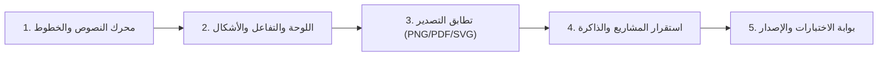

# خطة الأوفرهول الشامل لإصدار أثر مستقر ومضمون (Athar Studio Stability Overhaul Plan)

> [!IMPORTANT]
> تهدف هذه الخطة إلى تحويل المشروع إلى إصدار مستقر ومضمون بالكامل: **تطابق 100% بين المعاينة والتصدير (PNG / Sticker / PDF / SVG)، حفظ واستعادة المشاريع دون فقدان أي خاصية، استقرار الذاكرة على صور 4K، واختبارات آلية شاملة قبل كل إصدار.**

---

## نظرة عامة على المراحل (Architecture & Phases)

---

## المرحلة 1: توحيد وضمان محرك النصوص والخطوط (Typography & Rich Text)

- [x] إصلاح زر «تطبيق» العلوي في `ArabicTextEditorDialog` لحفظ `textSpans` وعدم ضياع تنسيق الكلمات.
- [x] إزالة `shader` التدرج اللوني للطبقة عبر `SolidSpanColor` في `AtharRichTextEngine` عند تحديد لون خاص لكلمة.
- [x] ضبط `TextDirectionHeuristics.FIRSTSTRONG_RTL` في `StaticLayout.Builder` لضمان اتجاه ومحاذاة النصوص العربية.
- [x] عرض الخطوط المخصصة (`customFonts`) في `FontPickerCarousel` ومحرّر الكلمات `ArabicTextEditorDialog`، ومنع دمج الخطوط ذات الاسم العام في `FontBrowserDialog`.
- [ ] توسيع اختبارات الوحدة لـ `AtharRichTextEngine` و`RichTextSpanMapper` مع النصوص المختلطة وأوضاع الكشيدة كافة.

---

## المرحلة 2: اللوحة والتفاعل والطبقات والأشكال (Canvas, Hit-Testing & Shapes)

- [x] دعم اختيار وسحب طبقات الأشكال (`ShapeLayerConfig`) في `CanvasHitTester.findHitLayer`.
- [x] تصفير `textSpans` و`shapeConfig` عند مسح آخر طبقة متبقية في `StudioLayerTypographyOps`.
- [x] معالجة تحذيرات البناء في `CanvasBitmapState.kt` و`TextGlassBackdropRenderer.kt` و`PhotoAdjustmentsPanel.kt`.
- [x] إضافة بطاقة «استوديو الكولاج 2.0» في الشاشة الرئيسية (`HomeCollageCard`) مع تخطيطات جديدة (`MAGAZINE_MOSAIC`, `POLAROID_DUO`, `BENTO_SIX`) والتعبئة السريعة بالصور وتبديل الخلايا والعكس الرأسي.
- [ ] التحقق من عدم إظهار أدوات النص عندما تكون الطبقة النشطة شكلاً هندسياً.

---

## المرحلة 3: التطابق الكامل بين المعاينة والتصدير (Export Parity: PNG / Sticker / PDF / SVG)

- [x] إضافة تصدير طبقات الأشكال الهندسية (`RECTANGLE`, `CIRCLE`, `FRAME`, `DIVIDER_H`, `DIVIDER_V`) في `AtharSvgExporter`.
- [x] مطابقة إحداثيات خلفيات الكلمات (`HighlightRect`) في `AtharSvgExporter` مع `AtharRichTextEngine`.
- [ ] دعم التدرجات المخصصة (`customGradient`) والخطوط المخصصة لكل كلمة في مسار SVG.
- [ ] التحقق من عدم قص الظلال أو التوهج الخارجي عند تصدير الملصقات الشفافة (`isStickerTrimmed = true`).

---

## المرحلة 4: استقرار المشاريع والأداء والذاكرة (Persistence, Performance & Memory)

- [x] تدوير وتحرير ذاكرة `Bitmap` لخلايا الكولاج غير المستخدمة في `CanvasBitmapState`.
- [ ] مراجعة تغطية التسلسل (`AtharProjectSerializer` و`AtharLayerJsonCodec`) لجميع الحقول والتوافق الرجعي.
- [ ] فحص الأداء على صور كبيرة (12MP+) أثناء تحريك أشرطة التمرير.

---

## المرحلة 5: بوابة الجودة والاختبارات والإصدار (QA Gate & Release Readiness)

- [x] إضافة اختبارات تخطيطات كولاج 2.0 وتصدير الأشكال في SVG ضمن `UltimateV4Tests`.
- [x] تشغيل `testReleaseUnitTest` و`lintRelease` و`assembleRelease` وإصدار الباتش `v4.0.1` (Build `55`).
- [ ] توسيع اختبارات `CanvasHitTester` لطبقات النصوص والأشكال مع الدوران والتكبير.
